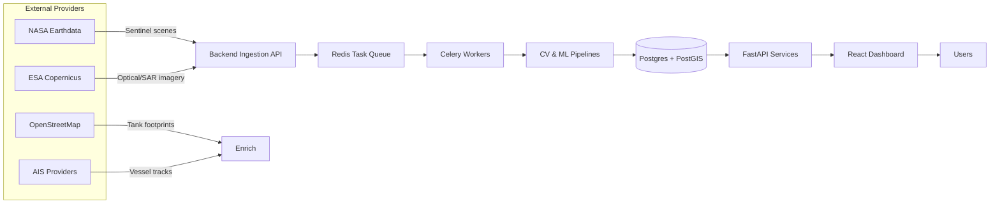

# Oil Storage Tank Monitor

A comprehensive web application for monitoring global oil storage tank levels using satellite imagery and machine learning.

> **Status:** Work in progress. Major components are under active development and subject to change.

## Overview

This project combines satellite imagery processing, geospatial analytics, and forecasting to estimate oil storage tank fill levels. The system ingests open satellite data, detects floating-roof shadows, and surfaces insights through a web dashboard.

## Repository Structure

- **`backend/`** FastAPI services, Celery workers, and data processing pipelines.
- **`frontend/`** React + TypeScript dashboard for visualization and monitoring.
- **`docker-compose.yml`** Local orchestration for Postgres, Redis, backend, and frontend services.
- **`setup.sh` / `test-setup.sh`** Convenience scripts for bootstrapping development and test environments.
- **`sentinel-2-scenes/`** Placeholder directory for downloaded satellite scenes.

## Features

- **Real-time Tank Monitoring**: Track oil storage levels using satellite imagery analysis
- **Shadow Analysis**: Use computer vision to detect floating roof positions via shadow geometry
- **Global Coverage**: Monitor major oil hubs worldwide (Cushing, Rotterdam, Fujairah, etc.)
- **Trend Analysis**: ML-powered forecasting and trend detection
- **Multi-source Data**: Integrate NASA/ESA satellite data, OpenStreetMap, and AIS data
- **Interactive Dashboard**: Real-time maps, charts, and analytics

## Work in Progress

- **Automated scene acquisition**: Improving reliability of NASA/ESA data downloads.
- **Model calibration**: Validating volume estimates against trusted datasets.
- **User management**: Hardening authentication and authorization flows.
- **Deployment hardening**: Security review of secrets management and infrastructure scripts.

## Architecture

The system is containerized via `docker-compose`, wiring together backend APIs, background workers, and the frontend dashboard. Redis brokers background tasks while Postgres/PostGIS stores geospatial assets and analysis outputs.

### High-Level Data Flow

### Backend (FastAPI)
- Satellite data ingestion orchestration (Sentinel-1, Sentinel-2)
- REST API for querying tanks, analysis, and imagery status
- Authentication, session management, and rate limiting (WIP)
- Configuration via Pydantic settings with `.env` overrides

### Background Workers (Celery)
- Asynchronous ingestion of new scenes and metadata
- Batch computer vision processing (roof shadow detection)
- ML inference for volume estimation and forecasting
- Scheduled jobs via Celery Beat for periodic tasks

### Storage & Infrastructure
- **Postgres + PostGIS**: Persistent store for sites, tanks, geometry assets, and time-series measurements.
- **Redis**: Task queue broker and cache for ephemeral state.
- **Object Storage (Planned)**: Long-term archival of processed scenes and intermediate rasters.
- **File System**: Local `data/` directories for cached satellite scenes during development.

### Frontend (React + TypeScript)
- Interactive maps (`MapLibre GL`) displaying tank footprints and fill status
- Real-time charts and dashboards backed by Web API polling (WebSockets planned)
- Admin interface for configuring locations and reviewing processing results

### Data Sources
- **Satellite Imagery**: NASA Earthdata, ESA Copernicus (Free)
- **Tank Locations**: OpenStreetMap Overpass API
- **Validation Data**: EIA crude oil storage reports
- **Optional AIS Feeds**: Vessel movement data for corroborating storage activity

## Getting Started

### Prerequisites
- Python 3.9+
- Node.js 16+
- PostgreSQL with PostGIS
- NASA Earthdata account (free)
- ESA Copernicus account (free)

### Installation

1. Clone the repository
2. Set up backend: `cd backend && pip install -r requirements.txt`
3. Set up frontend: `cd frontend && npm install`
4. Configure environment variables
5. Run migrations: `alembic upgrade head`
6. Start services: `docker-compose up`

### Quick Start with Docker

1. Run `./setup.sh` to provision `.env` files and bootstrap containers.
2. Visit the frontend at `http://localhost:3000` and API docs at `http://localhost:8000/docs`.
3. Monitor container logs using `docker-compose logs -f`.

## Usage

1. **Configure Tank Sites**: Add oil storage locations via admin interface
2. **Satellite Data**: Automatic daily pulls from NASA/ESA APIs
3. **Analysis**: Real-time computer vision processing
4. **Monitoring**: View trends and forecasts on dashboard

## API Endpoints

- `GET /api/sites` - List all monitored sites
- `GET /api/tanks/{site_id}` - Get tanks for a site
- `GET /api/analysis/{tank_id}` - Get analysis results
- `POST /api/scenes/process` - Trigger image processing

## License

MIT License
